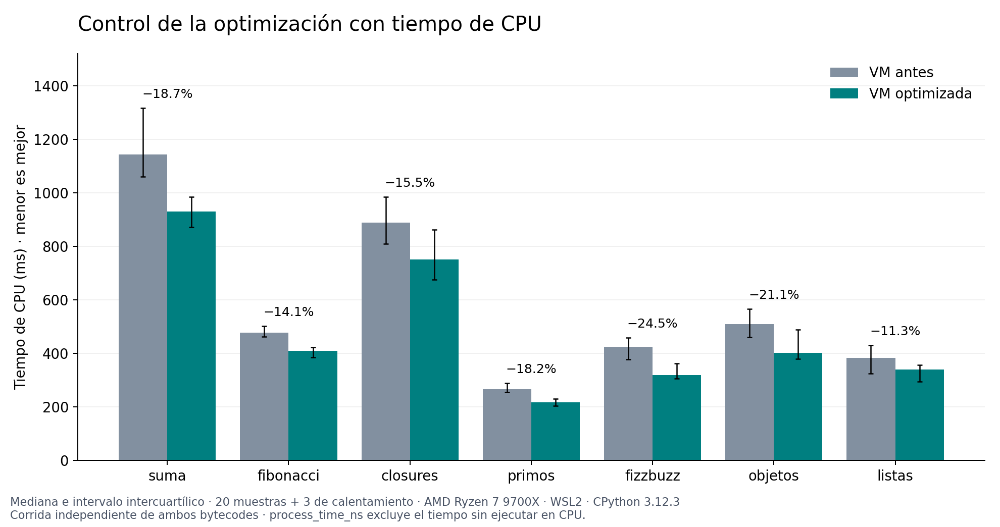
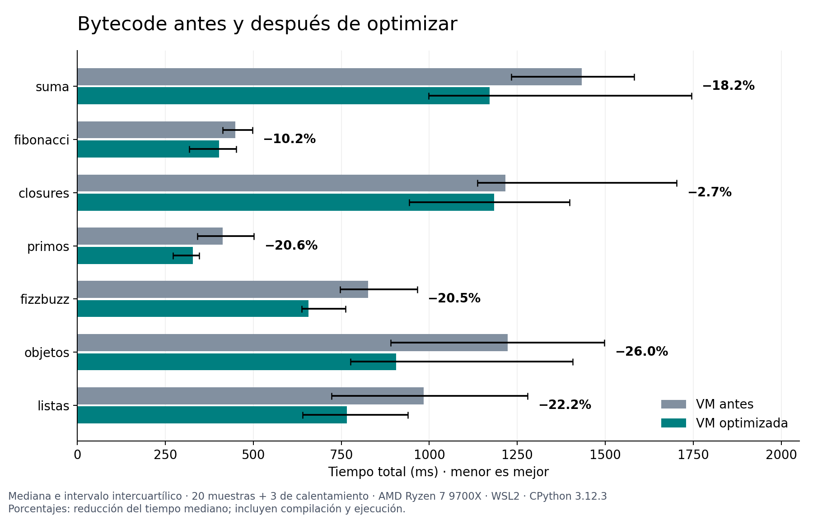
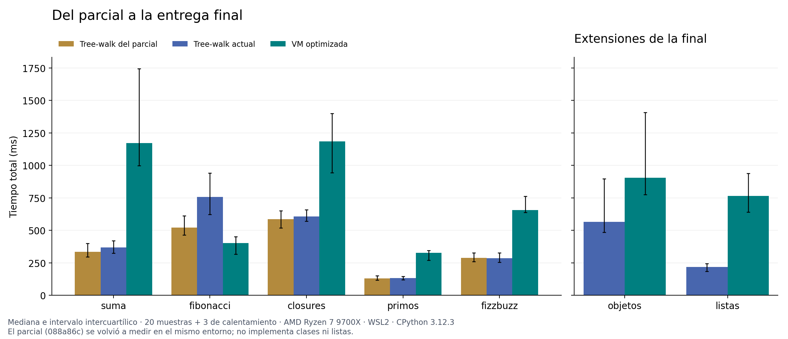
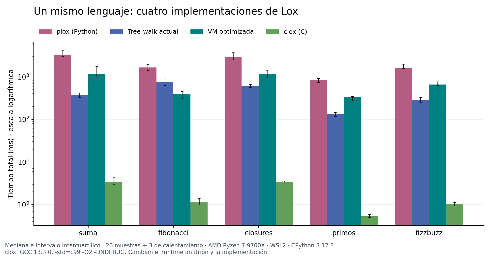
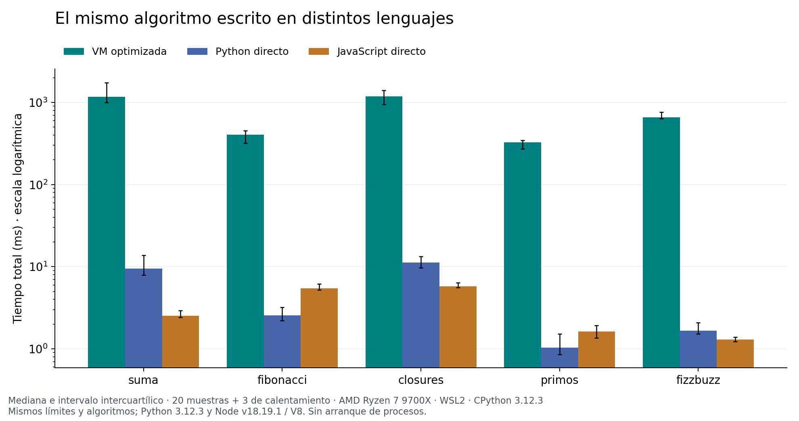
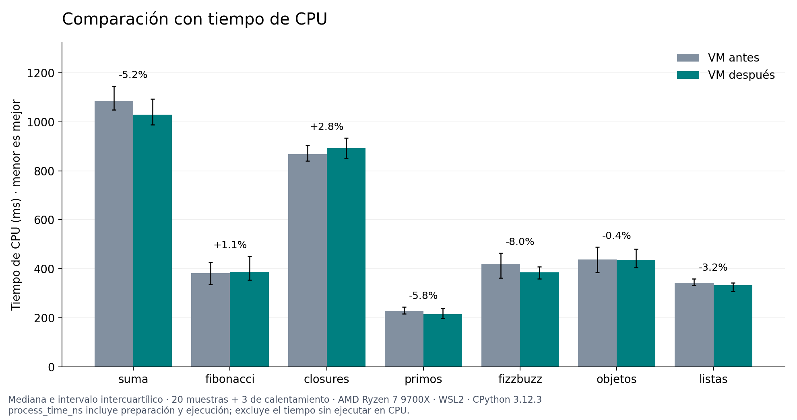

# Benchmarks de la entrega final

Las tablas principales usan la versión de
[optimized.json](../benchmarks/baselines/optimized.json). «Actual» se refiere
a esa versión medida. Las correcciones de paridad y REPL se midieron después
y tienen su propia comparación al final.

Las optimizaciones redujeron la mediana del tiempo de CPU de la VM entre
**11,3% y 24,5%**, según el programa. El bytecode sigue siendo más lento que
el tree-walk en seis de las siete cargas; en Fibonacci es más rápido.
La compilación representa menos del 0,21% del tiempo total de estas cargas:
el costo principal está en ejecutar las instrucciones desde Python.

## Versiones y entorno

Mediciones del 11 de noviembre de 2026, en la misma máquina:

| Componente | Versión |
|---|---|
| CPU | AMD Ryzen 7 9700X; 8 CPU lógicas visibles en WSL |
| Sistema | Ubuntu en WSL2, kernel 6.18.33.2-microsoft-standard-WSL2, glibc 2.39 |
| Afinidad | CPU lógica 2 para todos los procesos medidos |
| Python | CPython 3.12.3, compilado con GCC 13.3.0 |
| C | GCC 13.3.0; clox compilado con `-std=c99 -O2 -DNDEBUG` |
| JavaScript | Node v18.19.1, V8 10.2.154.26-node.28 |
| Gráficos | Matplotlib 3.10.1 y NumPy 2.2.4; generados fuera de las mediciones |

El parcial corresponde a `088a86c2c86816dea2bbd3d3bb5fe549855ccf6d`.
La versión anterior a optimizar ya tenía clases y listas, por lo que esa
comparación mantiene la misma funcionalidad. Las
[referencias](../benchmarks/baselines/README.md) conservan commit base, parche
y hashes de las fuentes.

Las referencias externas están fijadas a
[plox 734f4d2](https://github.com/FdelMazo/plox/tree/734f4d2adaf708c503dc5d17e88315e273c2f0ab)
y [clox 4a840f7](https://github.com/munificent/craftinginterpreters/tree/4a840f70f69c6ddd17cfef4f6964f8e1bcd8c3d4/c).
plox es un tree-walk en Python; clox es una VM en C. No medimos jlox porque
el entorno Linux no tenía Java; sus resultados anteriores usan otro entorno.

## Cómo medimos

- **20 muestras y 3 ejecuciones de calentamiento** por combinación. Se informa
  mediana e intervalo intercuartílico, del percentil 25 al 75. Las barras de
  error muestran dispersión de muestras, no intervalos de confianza.
- Los medidores Python alternan las variantes en orden aleatorio en cada ronda,
  con semilla 1111. clox y JavaScript se miden después, en lotes separados,
  con las mismas repeticiones y afinidad. El equipo podía tener otras tareas activas.
- El tiempo de pared incluye preparación y ejecución: lexer, parser/resolver
  o compilador, creación del runtime y ejecución. Cada muestra recibe un
  runtime nuevo y compila otra vez la fuente. Se excluyen arranque del proceso,
  importaciones, lectura de archivos y compilación del harness de C.
- Se captura stdout y se verifica el resultado de **cada ejecución**, incluidos
  los calentamientos. clox admite notación científica equivalente; una salida
  distinta o un error detienen la medición.
- El GC permanece habilitado. La recolección explícita previa a cada muestra
  Python/JavaScript queda fuera del cronómetro. clox incluye inicializar y
  liberar su VM. Los costos de gestión de memoria no quedan exactamente
  equiparados entre runtimes.
- La corrida general usa tiempo de pared. Al observar dispersión alta, hicimos
  una **segunda corrida solo del antes/después**, registrando además
  `process_time_ns`. El tiempo de CPU excluye los períodos en que el proceso
  no está ejecutando, pero sigue sujeto a frecuencia, temperatura y efectos
  de virtualización. No mezclamos sus milisegundos con los de la primera corrida.

La captura tiene diferencias pequeñas entre runtimes: Python y JavaScript
escriben en memoria; clox formatea y escribe al buffer de stdio, y vacía ese
buffer fuera del intervalo. JavaScript crea un contexto de `vm.Script` nuevo
por muestra y ese costo se incluye en ejecución. Tres calentamientos no
prueban que el JIT haya alcanzado un estado estable.

## Programas

| Programa | Trabajo realizado |
|---|---|
| suma | 100.000 iteraciones con aritmética y asignación; resultado 5.000.050.000 |
| fibonacci | Suma `fib(0)` a `fib(20)` mediante recursión; resultado 17.710 |
| closures | Crea 30.000 sumadores y llama 30.000 veces a un contador capturado |
| primos | Cuenta primos hasta 300 por división por tentativas; resultado 62 |
| fizzbuzz | Construye una cadena para los números 1 a 400 |
| objetos | 20.000 llamadas con campos, métodos y `super`; resultado 200.030.000 |
| listas | Agrega, indexa, modifica y extrae 10.000 elementos; resultado 100.010.000 |

Los cinco primeros son portables entre las implementaciones de Lox medidas.
Primos y FizzBuzz usan restas sucesivas para divisibilidad, porque clox no tiene
`%`. Las traducciones a Python y JavaScript conservan los mismos algoritmos,
límites y trabajo; no los sustituyen por funciones de biblioteca o `%`.
Los acumuladores numéricos de Python se inicializan como `float`.

Clases se compara con nuestros backends y clox. Listas se compara solamente
entre nuestros backends: es una extensión propia. Son cargas sintéticas; la
[demo del combate](../examples/combate.lox) tiene un objetivo concreto, pero
es demasiado corta para sacar conclusiones de rendimiento.

## Optimización: antes y después

Medianas de **tiempo de CPU**, en milisegundos, de la corrida de control:

| Programa | VM antes | VM optimizada | Reducción de tiempo |
|---|---:|---:|---:|
| suma | 1143.64 | 929.97 | 18.7% |
| fibonacci | 476.94 | 409.69 | 14.1% |
| closures | 887.98 | 750.46 | 15.5% |
| primos | 265.56 | 217.24 | 18.2% |
| fizzbuzz | 424.03 | 320.13 | 24.5% |
| objetos | 508.69 | 401.29 | 21.1% |
| listas | 383.74 | 340.31 | 11.3% |

La reducción es `100 × (1 − después / antes)`, usando las medianas.



En tiempo de pared, las medianas bajaron entre 2,7% y 26,0%, con mucha
dispersión. En closures, la diferencia es menor que la variación entre
muestras. El control de CPU ayuda a contrastar el resultado, pero estos
porcentajes de pared no prueban significancia estadística.



### Qué cambiamos

1. `Chunk` expone una `memoryview` de solo lectura. El closure guarda esa vista
   y el pool de constantes; cada frame reutiliza las referencias. El bucle lee
   directamente el opcode y las constantes, sin atravesar los métodos
   `Chunk.read`, `Chunk.constant` y `Chunk.__len__` en cada instrucción.
2. Las operaciones frecuentes se enlazan a variables locales del bucle.
   `push` usa `list.append` directamente. `pop` y `peek` mantienen sus chequeos;
   también se conservan la validación de tipos, las líneas de errores y el
   `match` con nombres de opcodes.

El chunk se termina antes de obtener sus vistas y mantiene el tamaño durante
la ejecución. Esta optimización conserva el bytecode emitido y el orden de
evaluación.

### Qué mostró el perfil

El perfil mide la ejecución con el programa ya compilado. Las 100.000
iteraciones de `suma` ejecutan 2.100.014 instrucciones de bytecode.

| Llamadas registradas por cProfile en suma | Antes | Después |
|---|---:|---:|
| Total, incluidas funciones internas | 25.400.170 | 12.600.087 |
| `VM.read_byte` | 3.500.023 | 1.400.009 |
| `Chunk.read` | 3.500.023 | 0 |
| `Chunk.__len__` | 2.100.014 | 0 |
| `VM.push` | 1.400.008 | 0 |

Las llamadas bajan 50,4%; en Fibonacci pasan de 8.826.041 a 4.670.728.
cProfile agrega costo a las llamadas, por lo que calculamos las mejoras de
tiempo con las corridas sin profiler. Después del cambio, `VM._run` concentra
cerca del 66% del tiempo perfilado de suma.

Los perfiles completos están en [antes/suma](../benchmarks/results/profile-before-suma.txt),
[después/suma](../benchmarks/results/profile-after-suma.txt),
[antes/Fibonacci](../benchmarks/results/profile-before-fibonacci.txt) y
[después/Fibonacci](../benchmarks/results/profile-after-fibonacci.txt).
Los pilotos de cinco muestras fueron exploratorios. Las tablas usan las
corridas de veinte muestras.

## Costo de la VM frente al tree-walk

La VM ejecuta en Python cada lectura de opcode, despacho, acceso a operandos,
operación de pila y validación de tipos. Los accesos directos reducen llamadas,
pero cada programa sigue requiriendo millones de esos pasos.

La preparación del backend bytecode ocupa una fracción pequeña del total:

| Programa | Preparación mediana (ms) | Mediana de preparación / total |
|---|---:|---:|
| suma | 0.327 | 0.027% |
| fibonacci | 0.423 | 0.107% |
| closures | 0.784 | 0.065% |
| primos | 0.686 | 0.203% |
| fizzbuzz | 0.885 | 0.128% |
| objetos | 0.593 | 0.068% |
| listas | 0.628 | 0.076% |

Reutilizar bytecode ya compilado ahorraría poco en estas cargas largas.
La proporción puede cambiar para programas cortos o con más trabajo de parseo.

Fibonacci es la excepción observada. La VM usa frames explícitos, variables
locales por índice y `OP_RETURN`; el tree-walk recorre nodos, crea entornos y
propaga el retorno con una excepción interna. Es una explicación consistente
con la ventaja de la VM en recursión, pero esta medición no aísla cuánto aporta
cada mecanismo por separado.

## Evolución desde el parcial

Medianas de tiempo de pared total, en milisegundos, medidas en el mismo entorno.
La última columna es `VM optimizada / tree-walk actual`;
un valor mayor que 1 significa que la VM tarda más.

| Programa | Parcial | Tree-walk actual | VM antes | VM optimizada | VM / tree-walk |
|---|---:|---:|---:|---:|---:|
| suma | 335.41 | 368.92 | 1432.75 | 1171.60 | 3.18× |
| fibonacci | 522.12 | 757.23 | 448.91 | 402.92 | 0.53× |
| closures | 587.20 | 607.28 | 1216.64 | 1183.83 | 1.95× |
| primos | 131.01 | 133.05 | 412.63 | 327.47 | 2.46× |
| fizzbuzz | 287.41 | 284.68 | 826.36 | 657.05 | 2.31× |
| objetos | — | 565.89 | 1222.65 | 905.29 | 1.60× |
| listas | — | 219.17 | 984.52 | 765.73 | 3.49× |



En Fibonacci, la VM actual tarda un 46,8% menos que el tree-walk actual y un
22,8% menos que el parcial. En las otras seis cargas tarda entre 1,60 y 3,49
veces lo que el tree-walk actual. Agregar compilación no produjo una mejora
uniforme de velocidad.

En Fibonacci, el tree-walk tarda un 45,0% más que el parcial. Entre esas
versiones cambiaron funcionalidades y semántica; la medición no aísla la
causa de esa regresión.

## Otras implementaciones y otros lenguajes

Medianas de pared, en milisegundos. Las primeras cuatro columnas ejecutan el
mismo Lox; las últimas dos ejecutan traducciones del algoritmo:

| Programa | plox | Tree-walk | VM optimizada | clox | Python directo | JavaScript directo |
|---|---:|---:|---:|---:|---:|---:|
| suma | 3320.853 | 368.925 | 1171.601 | 3.427 | 9.445 | 2.529 |
| fibonacci | 1656.777 | 757.231 | 402.922 | 1.124 | 2.543 | 5.455 |
| closures | 2932.197 | 607.279 | 1183.829 | 3.478 | 11.289 | 5.781 |
| primos | 852.050 | 133.046 | 327.470 | 0.537 | 1.029 | 1.622 |
| fizzbuzz | 1642.233 | 284.678 | 657.050 | 1.031 | 1.657 | 1.303 |



Nuestros dos backends tardan menos que plox. Los tree-walk difieren en
visitor, resolución y objetos de runtime; no medimos el efecto separado de
cada decisión. clox es mucho más rápido y ejecuta en C: cambian a la vez
la arquitectura, el lenguaje anfitrión y la representación de valores.



Python y JavaScript ejecutan los algoritmos sin nuestra capa de interpretación
de Lox y tardan mucho menos que la VM. Python gana en Fibonacci y primos;
JavaScript, en los otros tres. El resultado depende de estas cargas y harnesses.

## Reproducir y verificar

Desde la raíz del repositorio, con Linux/WSL, Python 3.12+, Git, GCC y Node.
El repositorio hermano `../plox` debe contener el commit indicado; el README
incluye los comandos para prepararlo en un checkout nuevo. clox se
obtiene automáticamente; si ya se dispone de ese commit, se puede pasar
`--clox-source /ruta/al/repo` a `external.py`. Se exigen al menos 20 GiB libres
antes de compilar.

```sh
python3 -B benchmarks/compare.py --snapshot benchmarks/baselines/optimized.json --cpu 2 --repetitions 20 --warmup 3 --output benchmarks/results/new/final.json
python3 -B benchmarks/external.py benchmarks/results/new/final.json
python3 -B benchmarks/compare.py --snapshot benchmarks/baselines/optimized.json --only-vm --cpu 2 --repetitions 20 --warmup 3 --output benchmarks/results/new/control.json
```

Elegir una CPU válida si el entorno no expone la CPU 2. Para graficar se necesitan
Matplotlib y NumPy, incluidos en el grupo opcional `bench` del lockfile.
Esta etapa también puede ejecutarse desde Windows, usando su propio entorno:

```sh
uv sync --group bench
uv run --group bench python -B benchmarks/plot.py benchmarks/results/new/final.json --control benchmarks/results/new/control.json --output benchmarks/graphs/new
```

El perfil puede reproducirse por separado, sin ejecutar simultáneamente los
benchmarks:

```sh
python3 -B benchmarks/profile_vm.py suma --before --output benchmarks/results/new/profile-before-suma.txt
python3 -B benchmarks/profile_vm.py suma --snapshot benchmarks/baselines/optimized.json --output benchmarks/results/new/profile-after-suma.txt
```

La verificación de esa etapa dio **416 tests aprobados**, más los **10 casos** de
aceptación estricta de la cátedra: cinco programas en cada backend.
Las dos corridas conservan 1.220 muestras con salidas verificadas.

- [Datos de la corrida general](../benchmarks/results/final.json) y [resumen CSV](../benchmarks/results/summary.csv).
- [Datos del control de CPU](../benchmarks/results/control.json) y [resumen CSV](../benchmarks/results/control-cpu-summary.csv).
- [Muestras de pared](../benchmarks/results/samples.csv) y [muestras del control, con ambos relojes](../benchmarks/results/control-samples.csv).
- [Salida de las verificaciones](../benchmarks/results/verification.txt).
- [Gráficos PNG y SVG](../benchmarks/graphs/).

Los JSON guardan las muestras originales, versiones, hashes y registro de
temporales. Los CSV son exportaciones para consultar muestras y estadísticas;
se regeneran con `plot.py`. Los TXT contienen perfiles de cProfile o salidas
de pruebas. El informe usa los perfiles para explicar el costo de la VM y
las verificaciones para identificar qué versión se probó.

## Correcciones de paridad y REPL

Después corregimos diferencias en declaraciones, comparaciones e impresión
de funciones, además del REPL y algunos errores de entrada. Comparamos las
versiones antes y después con 20 muestras y 3 calentamientos por combinación:
280 muestras nuevas, separadas de las anteriores.

Medianas de tiempo de CPU, en milisegundos. Una variación negativa indica
menos tiempo:

| Programa | Antes de corregir | Después de corregir | Variación |
|---|---:|---:|---:|
| suma | 1084.792 | 1028.425 | −5,2% |
| fibonacci | 382.609 | 386.879 | +1,1% |
| closures | 868.623 | 892.653 | +2,8% |
| primos | 229.242 | 215.953 | −5,8% |
| fizzbuzz | 419.596 | 385.929 | −8,0% |
| objetos | 438.807 | 436.998 | −0,4% |
| listas | 343.757 | 332.759 | −3,2% |



Los opcodes de `<=` y `>=` corrigen el resultado con `NaN` y ahorran una
instrucción por comparación. Bajan las medianas de suma, primos y fizzbuzz,
pero la corrida incluye todas las correcciones: no aísla el efecto de cada una.

Fibonacci y closures suben ligeramente; objetos queda casi igual. Los
intervalos intercuartílicos se superponen en todas las cargas, así que las
diferencias no son concluyentes. El [gráfico de pared](../benchmarks/graphs/delivery/bytecode-before-after.png)
muestra los tiempos de esta misma corrida.

Para repetir esta comparación con las fuentes medidas:

```sh
python3 -B benchmarks/compare.py --baseline benchmarks/baselines/optimized.json --snapshot benchmarks/baselines/delivery.json --only-vm --cpu 2 --repetitions 20 --warmup 3 --output benchmarks/results/new/delivery.json
uv run --group bench python -B benchmarks/plot.py benchmarks/results/new/delivery.json --only-vm --control benchmarks/results/new/delivery.json --output benchmarks/graphs/new/delivery
```

Esta versión pasó 455 tests, los 10 casos de aceptación y las tres demos en
ambos backends. También se comprobaron el lockfile y las referencias históricas.

- [Datos, hashes y limpieza](../benchmarks/results/delivery/final.json).
- [Resumen de CPU](../benchmarks/results/delivery/control-cpu-summary.csv) y [muestras con ambos relojes](../benchmarks/results/delivery/samples.csv).
- [Salida de las verificaciones](../benchmarks/results/delivery/verification.txt).

## Tree-walk vs bytecode (mylox)

Comparación interna de las dos fases de mylox sobre los mismos cinco programas:

| programa | tree-walk (ms) | bytecode (ms) | bytecode / tree-walk |
|---|---:|---:|---:|
| closures.lox | 606.98 | 1296.08 | 2.14x más lento |
| fibonacci.lox | 436.29 | 562.17 | 1.29x más lento |
| fizzbuzz.lox | 229.38 | 552.33 | 2.41x más lento |
| primos.lox | 165.57 | 381.18 | 2.30x más lento |
| suma.lox | 424.50 | 1380.13 | 3.25x más lento |

### Conclusiones

1. **En Python, el backend bytecode es más lento que el tree-walk**, no más rápido. Esto es lo opuesto a lo que ocurre en `clox`, donde la VM de bytecode es mucho más rápida que el tree-walk. La causa acá es el lenguaje de implementación: CPython ejecuta un `while` con `match`/`case` por cada instrucción de bytecode, lo que añade más overhead que evaluar directamente en el AST, porque cada operación del programa paga el costo del despacho de la VM además del de la operación.
2. **La diferencia es mayor en programas con mucha aritmética** (`suma.lox` 3.25x) que en los dominados por recursión (`fibonacci.lox` 1.29x). En recursión, el tree-walk ya paga el costo de crear entornos Python por cada llamada; la VM, aunque también crea frames, los gestiona sobre un array, lo que amortigua la penalización por el despacho.
3. **El bytecode sigue siendo valioso en Python** por razones que el benchmark de tiempo no captura: desacoplamiento entre compilación y ejecución, posibilidad de inspeccionar/depurar el bytecode (`--debug`), y una base lista para cuando el lenguaje de implementación cambie (por ejemplo, a Cython o a un JIT).
4. **La conclusión** es la misma que la del benchmark contra `clox`: la arquitectura de bytecode VM puede ser en órdenes de magnitud más rápida, pero solo cuando el lenguaje de implementación lo permite. En Python puro, el tree-walk es el backend más rápido; el bytecode es el más portable y depurable.